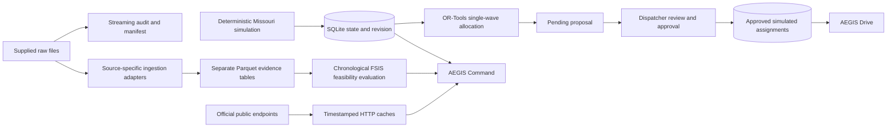

# Architecture

AEGIS runs as a local FastAPI service with a built React/TypeScript frontend. It can also use Vite's development server. SQLite stores the simulated operational state, proposals, approved assignments, and audit history. Downloaded raw files are read-only inputs.

## Module responsibilities

| Module | Responsibility |
|---|---|
| `backend/paths.py` | Repository paths, data-folder selection, JSON output |
| `backend/adapters.py` | Cached HTTP; Open-Meteo, NWS, NCEI, recalls, MoDOT, OSRM |
| `backend/route_review.py` | Route/event geometry intersections and 250-meter proximity review |
| `backend/route_lab.py` | Isolated single-farm/multi-depot route experiments with capacity, service-time, return, inventory and deadline constraints |
| `backend/custom_operations.py` | Strict bounded custom origin/stop/truck inputs and explicit planning provenance |
| `backend/dispatch.py` | Transactional incident review, lot holds/releases and versioned instruction acknowledgment |
| `backend/cold_chain.py` | Uncalibrated first-order cargo-temperature scenario projection and parameter sensitivity |
| `backend/weather_coverage.py` | NOAA station identity, coordinates, dates, units, quality flags and variable-level coverage |
| `backend/ingestion/fsis.py` | Recognize embedded product metadata and read primary poultry results |
| `backend/ingestion/nors.py` | Validate NORS columns and preserve historical outbreak evidence |
| `backend/ingestion/beam.py` | Preserve BEAM export schemas as separate evidence |
| `backend/ingestion/establishments.py` | Read official directory, select Missouri, parse coordinates |
| `backend/simulation.py` | Fixed-seed fictional network, telemetry, operational events |
| `backend/optimization.py` | Four constrained single-wave allocation scenarios |
| `backend/main.py` | HTTP endpoints, transactional proposals, approval and driver workflow |
| `scripts/train_model.py` | Lagged retrospective feasibility study and measured results |
| `scripts/validate_model_timing.py` | Frozen earlier-snapshot sensitivity study and explicit availability audit |
| `scripts/acquire_noaa.py` | Bounded five-station downloads preserving original bytes, SHA and retrieval metadata |

## State and approval

The state row contains a network revision. A proposal records its source revision and the solver output. Approval requires an actor and reason, checks that the proposal remains pending, rejects a changed network, and reruns safety validation. Approval and assignment publication occur in a SQLite transaction. New simulated events invalidate published assignments. Reset restores the seed and advances the revision; audit history is retained.

The present allocation is a snapshot plan. It does not represent physical departure or decrement inventory on real delivery. Driver acknowledgment is a recorded confirmation of an approved simulated assignment. Dispatcher identity is self-declared for a local demonstration; this is not an authenticated deployment.

The dispatcher router adds structured incidents and persistent instruction counters. Report snapshots preserve the original assignment context; later scenario resets do not rewrite history. Manual holds advance the network revision and remove only affected assignments; release does not redispatch. Instruction acknowledgment checks the exact current version, independently of assignment acknowledgment. Read-side desk panels share one SQLite snapshot. Earlier audit-only reports retain their original audit representation.

The route laboratory is an independent planning experiment. It uses OR-Tools RoutingModel for capacitated routes starting/ending at assigned farm/depot origins, with ten-minute stop service, deadlines, shift horizon and per-origin inventory. Held/recalled/ineligible stops are dropped, and insufficient stock or fleet capacity yields explicit unmet demand. OSRM matrices/geometries and estimated travel retain separate provenance. The heuristic reports FEASIBLE rather than asserting global optimality. Laboratory routes cannot mutate dispatcher assignments.

`AEGIS_DB_PATH` optionally selects a separate SQLite file, used by browser QA on port 8001 so tests never reset the operator's database on port 8000.

## Source boundaries

FSIS primary-test Salmonella positivity is the sole modeled outcome. Secondary serotyping is not counted as another primary sample. BEAM human surveillance, NORS historical outbreaks, official recalls, weather, and road disruptions remain distinct evidence layers. Matching real recall records to fictional lots is not scientifically supported and is not performed.

Each public response retains its URL and retrieval timestamp. Provider observation/forecast timestamps are preserved in payloads. Forecasts use an explicit America/Chicago request timezone; NWS alert timestamps retain their supplied offsets. Station daily dates must not be treated as hourly UTC observations. A missing NOAA dataset cannot be substituted by forecasts or simulated cargo temperature.

Generated responses live under `data/cache/`. `scripts/freeze_demo_evidence.py` creates dated demo snapshots under `data/fixtures/`; evidence endpoints fall back to fixtures if caches are missing and expose the fixture flag. `scripts/demo_run.py` uses a temporary SQLite database for workflow verification and writes `reports/demo_results.json`, keeping the operator's existing database unchanged.

NOAA original response bytes and checksum metadata are preserved separately under `data/external/noaa/`, outside the supplied-file audit. Coverage is a distinct report rather than an unvalidated FSIS join. The expanded observation window is January 1, 2025–June 30, 2026; all 2,730 requested station-day rows were returned, but nine precipitation values are missing.

MoDOT refresh discovers and queries incident layers as GeoJSON, retaining per-layer retrieval metadata and coverage warnings. Route review checks point and line proximity/intersection against every returned OSRM alternative. The review buffer is 250 meters. It can include adjacent roads and repeated point/line representations of an event; it is an operational review signal, not a verified route closure or commercial-vehicle clearance.

## Deployment scope

Documented startup binds to `127.0.0.1`. External HTTP services and map tiles require network access; dated cache and route estimates support a limited offline demo. Production identity, multi-user permissions, secrets management, commercial-truck routing, monitoring, and hosted infrastructure are outside the current verified implementation.

## Decision-depth and team-brief extension

`backend/plan_review.py` recomputes resource sums and eligibility independently of
OR-Tools. Approval rejects canonical-field tampering even if a faulty solver
returned the same corrupted result twice. UI explanations distinguish direct
exclusions from joint allocation nonselection; neither is a causal solver proof.

`backend/planning.py` stores immutable request/result runs with SHA-256 checksums.
Versioned projects point to runs; transactional expected-version updates preserve
history, and archiving preserves all versions. The laboratory writes no network,
stock or assignment changes. Saved source timestamps remain historical snapshots.
CSV exports neutralize formula-leading text and are explicitly planning-only.

`backend/data_explorer.py` allowlists source-specific Parquet tables. Arrow scans
bounded pages (1?100 rows, maximum offset 10,000) and literal case-insensitive
column filters. Schemas and derived-file hashes are exposed; errors do not merge
or invent observations. Null counts are per-page, not global missingness.

Targeted scenario-B verification records identity, reason, checklist, assignment
context, network revision and review version. Stale edits are rejected; completing
review does not change lot disposition or certify safety. Assignment acknowledgment
is separate from verification review and versioned instruction acknowledgment.

`config/feature_register.yaml` is the maintained capability register.
`scripts/verify_project.py` captures actual check exits, timestamps and immutable
log history. `scripts/build_project_brief.py` generates a PDF and Markdown from
that register and measured source/model/test artifacts. The status API serves
recorded evidence without promoting pending Kiro, browser or live-source checks.

## Visual Drive and bounded source transport (October 27)

`backend/drive.py` provides consistent approved-trip snapshots and deterministic
vehicle assumptions without GPS or physical sensors. Versioned focus records
expire after 600 seconds. Legacy report/assignment-ack/instruction-ack paths check
active parked confirmation inside serialized SQLite mutation transactions.
The gate records a declaration; it cannot prove actual motion or physical parking.

The `?mode=drive` entry hides Command navigation and loads only network context
plus the lightweight per-truck snapshot. It does not poll bulk recall, inventory,
model or road-layer payloads. Route requests are explicit parked-use actions.

Recall evidence supports an explicit bounded preview while preserving original
provider order, schema, complete cache bytes and total/returned/truncation counts.
Refresh buttons request metadata summaries; full responses remain available for
source audits. Cached fallbacks, including nested stale MoDOT layers, retain
failure/freshness flags rather than being promoted to provider success.
Core evidence-cache JSON is published as complete files with coordinated in-process reads
and replacement retries for Windows sharing locks. Original raw files are never
written by these helpers.

Driver trip acknowledgments and reports include the displayed network revision.
A transactional guard rejects stale context even when a shipment ID is reused
for another lot. Legacy callers can omit this optional field for compatibility;
this is not production authorization or authenticated driver identity.
