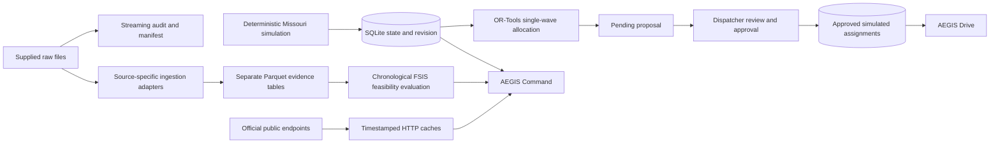

# Architecture

## Local startup and activity inspection (October 29)

`scripts/start_local.py` validates effective dotenv/environment settings before
any operator database access, checks an occupied loopback listener before
building, validates local frontend assets and runs its owned Uvicorn child in
the foreground. `Start-AEGIS.cmd` is a Windows convenience entry point. Explicit
prebuilt mode makes no source-freshness claim; check-only never opens SQLite.
An already responding service is inspected without restarting or rebuilding it.

`backend/activity.py` reads bounded existing audit rows through a separate
SQLite read-only/query-only transaction. Stable captured pagination excludes
later higher IDs and rejects changes in the inspected prefix. Exact payload
hashes are distinct from explicitly bounded prefix hashes. The React activity
panel is navigation/inspection/export only and adds no tenth workspace or action
authority. Actor text is self-declared and missing historical effects stay
missing; this is not a tamper-proof event-sourcing ledger.

## Command feedback and impact comparison (October 29)

`backend/event_impact.py` captures bounded network and assignment records with
SQLite `mode=ro`/`query_only` and computes a pure before/after experiment with
the existing simulator and all four allocation scenarios. A second read rejects
changed input state. Preview is independent of provider/model calls and never
initializes, seeds, writes a proposal or clears an assignment.

The Command UI requires preview plus explicit consent before applying an event.
The event transaction checks the expected revision and recomputed preview hash,
then records the event, advances revision and clears every approved assignment
atomically. Legacy API clients may still apply directly without a preview;
providing a preview requires its revision. No preview creates an approval.

Map allocation projections and road-alternative highlighting are display state.
They do not change optimizer OD inputs, stop order or approved assignments.
Route geometry comes only from an explicit request and stays separate from
simulated two-hour delays and source overlays. Inline results/errors, captured
exports and per-workspace guides distinguish these steps. See
`docs/command_workflow.md` and `docs/event_impact.md` for exact semantics.

`backend/evidence_assistant.py` captures network and approved assignments with
a separate SQLite `mode=ro`, `query_only` transaction; it never initializes or
seeds a missing database. Report hashes and parsing use the same bounded bytes,
but separate files are not a globally atomic provider snapshot. Content hashes
bind six server-authored explanation topics to the captured context.
`backend/assistant_intent.py` optionally classifies a question through a bounded
Ollama loopback call; no operational data/tools are sent and only a topic enum
is accepted. Fact text remains deterministic and stale contexts are rejected.

AEGIS runs as a local FastAPI service with a built React/TypeScript frontend. It can also use Vite's development server. SQLite stores the simulated operational state, proposals, approved assignments, and audit history. Downloaded raw files are read-only inputs.

The read-only road workspace (`backend/road_intelligence.py`) keeps MoDOT and
Iowa DOT adapters separate, validates bounded point/line geometry, and screens
captured route alternatives without opening SQLite. Its offline profile reads
dated fixtures only. Local state recovery (`scripts/backup_state.py`) uses
SQLite's online backup and verifies restored copies without rebinding the app;
private backups and recovery receipts stay out of Git and reviewer packages.
See [road intelligence](road_intelligence.md) and [recovery](backup_restore.md).

## Module responsibilities

| Module | Responsibility |
|---|---|
| `backend/paths.py` | Repository paths, data-folder selection, JSON output |
| `backend/adapters.py` | Cached HTTP; Open-Meteo, NWS, NCEI, recalls, MoDOT, OSRM |
| `backend/route_review.py` | Route/event geometry intersections and 250-meter proximity review |
| `backend/route_lab.py` | Isolated single-farm/multi-depot route experiments with capacity, service-time, return, inventory and deadline constraints |
| `backend/custom_operations.py` | Strict bounded custom origin/stop/truck inputs and explicit planning provenance |
| `backend/dispatch.py` | Transactional incident review, lot holds/releases and versioned instruction acknowledgment |
| `backend/cold_chain.py` | Uncalibrated first-order cargo-temperature scenario projection and parameter sensitivity |
| `backend/weather_coverage.py` | NOAA station identity, coordinates, dates, units, quality flags and variable-level coverage |
| `backend/ingestion/fsis.py` | Recognize embedded product metadata and read primary poultry results |
| `backend/ingestion/nors.py` | Validate NORS columns and preserve historical outbreak evidence |
| `backend/ingestion/beam.py` | Preserve BEAM export schemas as separate evidence |
| `backend/ingestion/establishments.py` | Read official directory, select Missouri, parse coordinates |
| `backend/ingestion/common.py` | Recursive supplied-input discovery, header inspection, hashes and complete derived-table publication |
| `backend/ingestion/usda.py` | Validate bounded USDA Food Environment Atlas county context, vintages, denominators and missing codes |
| `backend/food_context.py` | Serve checked USDA Parquet snapshots and CSV without operational or safety inference |
| `backend/readiness.py` | Read-only hard-constraint and human-workflow checks for approved simulated assignments |
| `backend/simulation.py` | Fixed-seed fictional network, telemetry, operational events |
| `backend/optimization.py` | Four constrained single-wave allocation scenarios |
| `backend/main.py` | HTTP endpoints, transactional proposals, approval and driver workflow |
| `scripts/train_model.py` | Lagged retrospective feasibility study and measured results |
| `scripts/validate_model_timing.py` | Frozen earlier-snapshot sensitivity study and explicit availability audit |
| `scripts/acquire_noaa.py` | Bounded five-station downloads preserving original bytes, SHA and retrieval metadata |

## State and approval

The state row contains a network revision. A proposal records its source revision and the solver output. Approval requires an actor and reason, checks that the proposal remains pending, rejects a changed network, and reruns safety validation. Approval and assignment publication occur in a SQLite transaction. New simulated events invalidate published assignments. Reset restores the seed and advances the revision; audit history is retained.

The present allocation is a snapshot plan. It does not represent physical departure or decrement inventory on real delivery. Driver acknowledgment is a recorded confirmation of an approved simulated assignment. Dispatcher identity is self-declared for a local demonstration; this is not an authenticated deployment.

The dispatcher router adds structured incidents and persistent instruction counters. Report snapshots preserve the original assignment context; later scenario resets do not rewrite history. Manual holds advance the network revision and remove only affected assignments; release does not redispatch. Instruction acknowledgment checks the exact current version, independently of assignment acknowledgment. Read-side desk panels share one SQLite snapshot. Earlier audit-only reports retain their original audit representation.

The route laboratory is an independent planning experiment. It uses OR-Tools RoutingModel for capacitated routes starting/ending at assigned farm/depot origins, with ten-minute stop service, deadlines, shift horizon and per-origin inventory. Held/recalled/ineligible stops are dropped, and insufficient stock or fleet capacity yields explicit unmet demand. OSRM matrices/geometries and estimated travel retain separate provenance. The heuristic reports FEASIBLE rather than asserting global optimality. Laboratory routes cannot mutate dispatcher assignments.

`AEGIS_DB_PATH` optionally selects a separate SQLite file, used by browser QA on port 8001 so tests never reset the operator's database on port 8000.

## Source boundaries

FSIS primary-test Salmonella positivity is the sole modeled outcome. Secondary serotyping is not counted as another primary sample. BEAM human surveillance, NORS historical outbreaks, official recalls, weather, and road disruptions remain distinct evidence layers. Matching real recall records to fictional lots is not scientifically supported and is not performed.

Each public response retains its URL and retrieval timestamp. Provider observation/forecast timestamps are preserved in payloads. Forecasts use an explicit America/Chicago request timezone; NWS alert timestamps retain their supplied offsets. Station daily dates must not be treated as hourly UTC observations. A missing NOAA dataset cannot be substituted by forecasts or simulated cargo temperature.

Generated responses live under `data/cache/`. `scripts/freeze_demo_evidence.py` creates dated demo snapshots under `data/fixtures/`; evidence endpoints fall back to fixtures if caches are missing and expose the fixture flag. `scripts/demo_run.py` uses a temporary SQLite database for workflow verification and writes `reports/demo_results.json`, keeping the operator's existing database unchanged.

NOAA original response bytes and checksum metadata are preserved separately under `data/external/noaa/`, outside the supplied-file audit. Coverage is a distinct report rather than an unvalidated FSIS join. The expanded observation window is January 1, 2025–June 30, 2026; all 2,730 requested station-day rows were returned, but nine precipitation values are missing.

MoDOT refresh discovers and queries incident layers as GeoJSON, retaining per-layer retrieval metadata and coverage warnings. Route review checks point and line proximity/intersection against every returned OSRM alternative. The review buffer is 250 meters. It can include adjacent roads and repeated point/line representations of an event; it is an operational review signal, not a verified route closure or commercial-vehicle clearance.

## Deployment scope

Documented startup binds to `127.0.0.1`. External HTTP services and map tiles require network access; dated cache and route estimates support a limited offline demo. Production identity, multi-user permissions, secrets management, commercial-truck routing, monitoring, and hosted infrastructure are outside the current verified implementation.

## Decision-depth and team-brief extension

`backend/plan_review.py` recomputes resource sums and eligibility independently of
OR-Tools. Approval rejects canonical-field tampering even if a faulty solver
returned the same corrupted result twice. UI explanations distinguish direct
exclusions from joint allocation nonselection; neither is a causal solver proof.

`backend/planning.py` stores immutable request/result runs with SHA-256 checksums.
Versioned projects point to runs; transactional expected-version updates preserve
history, and archiving preserves all versions. The laboratory writes no network,
stock or assignment changes. Saved source timestamps remain historical snapshots.
CSV exports neutralize formula-leading text and are explicitly planning-only.

`backend/data_explorer.py` allowlists source-specific Parquet tables. Arrow scans
bounded pages (1?100 rows, maximum offset 10,000) and literal case-insensitive
column filters. Schemas and derived-file hashes are exposed; errors do not merge
or invent observations. Null counts are per-page, not global missingness.

Targeted scenario-B verification records identity, reason, checklist, assignment
context, network revision and review version. Stale edits are rejected; completing
review does not change lot disposition or certify safety. Assignment acknowledgment
is separate from verification review and versioned instruction acknowledgment.

`config/feature_register.yaml` is the maintained capability register.
`scripts/verify_project.py` captures actual check exits, timestamps and immutable
log history. `scripts/build_project_brief.py` generates a PDF and Markdown from
that register and measured source/model/test artifacts. The status API serves
recorded evidence without promoting pending Kiro, browser or live-source checks.

## Visual Drive and bounded source transport (October 27)

`backend/drive.py` provides consistent approved-trip snapshots and deterministic
vehicle assumptions without GPS or physical sensors. Versioned focus records
expire after 600 seconds. Legacy report/assignment-ack/instruction-ack paths check
active parked confirmation inside serialized SQLite mutation transactions.
The gate records a declaration; it cannot prove actual motion or physical parking.

The `?mode=drive` entry hides Command navigation and loads only network context
plus the lightweight per-truck snapshot. It does not poll bulk recall, inventory,
model or road-layer payloads. Route requests are explicit parked-use actions.

Recall evidence supports an explicit bounded preview while preserving original
provider order, schema, complete cache bytes and total/returned/truncation counts.
Refresh buttons request metadata summaries; full responses remain available for
source audits. Cached fallbacks, including nested stale MoDOT layers, retain
failure/freshness flags rather than being promoted to provider success.
Core evidence-cache JSON is published as complete files with coordinated in-process reads
and replacement retries for Windows sharing locks. Original raw files are never
written by these helpers.

Driver trip acknowledgments and reports include the displayed network revision.
A transactional guard rejects stale context even when a shipment ID is reused
for another lot. Legacy callers can omit this optional field for compatibility;
this is not production authorization or authenticated driver identity.

## Source identity and county context (October 27)

Source-specific ingestion now discovers supplied files recursively while
excluding generated/runtime trees. CSV/TSV headers select stable NORS, five BEAM
and establishment identities; raw-poultry JSON requires embedded product
metadata and primary-row validation. Exact duplicate downloads are represented
once. Conflicting export snapshots require explicit input selection instead of
silent concatenation or filename-based recency. Per-file errors remain recorded
while other sources continue. Complete Parquet publication preserves prior bytes
when a writer fails. See [the ingestion guide](ingestion_provenance.md),
[identity regressions](../tests/test_ingestion_identity.py) and
[the recorded re-ingestion comparison](../reports/ingestion_verification.json).

The data explorer reads a derived table into one bounded snapshot, verifies its
manifest checksum and schema, and parses those same bytes. Its 64 MiB snapshot
bound is separate from the 1-100 returned rows and maximum offset of 10,000.
Latest failed/conflicting/omitted inputs do not silently promote an older output
to current evidence. Legacy tables without input manifests retain an explicit
provenance warning. FSIS, NORS and BEAM remain separate scientific evidence.

The USDA adapter extracts 115 Missouri counties/county-equivalents and ten
ACCESS/STORES variables into a separate Parquet table/report. The food-context
router verifies the derived checksum before serving values from those same
bytes. Its UI compares selected FIPS identities and exports county context; it
does not spatially assign destinations, create a risk score, alter demand or
change optimization. Access measures use 2019 store data with older Census/ACS
inputs; store measures use 2020 and 2023. Grocery count/rate each retain 39 nulls.
See [the county-context guide](food_access_context.md) and
[API integrity tests](../tests/test_food_context.py).

## Read-only assignment readiness

`GET /api/readiness` reads network state and approved assignments within one
SQLite snapshot. It reports sixteen checks per assignment: thirteen hard
eligibility/resource checks and three outstanding workflow checks. Aggregate
lot, truck, origin, supplier and destination use is recomputed across the
current allocation. The UI separates constraint blocks, review outstanding and
listed checks passed, and hides results from a mismatched network revision.

This diagnostic does not approve, dispatch, consume stock, create holds or
certify safety. Versioned instruction acknowledgments and matching scenario-B
verification records remain distinct from trip acknowledgment. Actual departure,
delivery execution, commercial-truck clearance and authenticated identities are
outside this report. [The workflow guide](operations_workflow.md) and
[read-only/concurrency tests](../tests/test_readiness.py) describe the boundary.

## Isolated rehearsal runtime

`scripts/start_rehearsal.py` creates one fresh UUID SQLite file and launches a
separate loopback process. `backend/runtime.py` validates the ID/path/offline
profile before database initialization; requests never rebind the global DB.
The operator app rejects rehearsal recording. Main network snapshots carry the
verified runtime context so every rehearsal view can display its banner without
adding bulk requests to dedicated Drive.

`backend/rehearsal.py` stores ordered, versioned stages and server-clock times in
the isolated database. Completed/aborted snapshots preserve audit/network state
and evidence-file hashes. Operational coverage requires coherent recorded
operations; manual coverage is explicitly self-reported. Exports never claim a
genuine human presentation, Kiro execution or author approval.

Offline rehearsal disables provider HTTP/cache access before lookup, rejects
source refresh and reads dated fixtures only. OSRM failures become labeled
estimates. Public base-map tiles and deliberately opened external links are
separate browser requests. Operator mode retains ordinary source refresh behavior.

## Guided delivery outlook

`backend/delivery_outlook.py` reads a bounded SQLite snapshot without writes,
copies simulated inputs and computes baseline A plus four changed-assumption
allocations with independent constraint checks. It reuses `cold_chain.py` for a
capped six-hour illustrative projection and rejects stale semantic snapshots.
`DeliveryOutlook.tsx` separates draft assumptions from captured output/export and
links to existing shipment/road review. No provider request, event application or
approval occurs. The historical FSIS estimator remains separate.

App copies an explicitly chosen candidate's endpoints, names and network revision
into a client-side `RoadJourneyContext`. Road comparison still sends the ordinary
coordinate request. Result attribution/export freezes that context at calculation
time; edits detach it and later network revisions warn about the older inputs.
Generic Road navigation uses an independent named example. Review shortcuts focus
the existing current-plan table without creating a proposal or dispatching.

## Save the Load and bounded sensor ingestion

`freshness_kinetics.py` evaluates chronological, timezone-aware product-temperature
history using explicit Q10 assumptions and bounded holds. Gaps, invalid coverage
or unsupported temperatures abstain. Ambient, humidity, vibration and ethylene
remain contextual channels. `freshness_planning.py` uses OR-Tools for constrained
FEFO/FIFO comparisons and ranks eligible rescue recipients; unknown quality,
holds, recalls, use-by caps and capacity remain binding.

`freshness.py` stores versioned sessions and append-only, idempotent sensor frames
in SQLite. Replay and bearer-authenticated gateway ingestion share the evaluator.
Read-only snapshots do not initialize tables. Batches, retained sessions and device
history are bounded; rejected/conflicting frames roll back atomically. Gateway
clocks age by server time even between packets. See `freshness_gateway.md`.

Rescue review binds a network/assignment digest, frame version, route and exact
independently checked whole-plan assignment set. Explicit three-part human review
is required to publish it. Drive opens the rescued truck/trip; later sensor frames
produce a persistent review advisory without redispatch. The reviewed lot retains
its original linked exposure session and decreasing use-by deadline; new or older
counterfactual experiments cannot reset that history. This remains a local
simulated decision-support system, without production identity or hardware claims.
