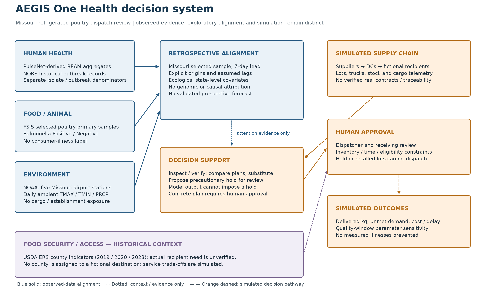

# One Health system and decision statement

The primary user is a **regional refrigerated-poultry dispatcher serving Missouri receiving sites**. Before a six-hour dispatch wave, or after a reported disruption, that person must decide which eligible inventory to allocate, which shipments need verification, whether to propose a precautionary hold, and whether eligible alternative supply preserves service. The prototype's suppliers, distribution centers, recipients, lots, trucks, inventory, costs and cargo telemetry are simulated. It does not establish real supplier contracts, recipient need or shipment traceability.

The dispatcher may inspect evidence, request information or verification, compare scenarios, propose eligible lot substitution and seek human hold/release or receiving approval. Existing holds and recalls, stock, truck capacity, eligibility, use-by, travel/deadline and receiving constraints remain binding. A score cannot impose a hold or certify a product. Human approval is required for high-consequence state changes; held or recalled lots cannot dispatch.

The research outcome is **Salmonella positivity in a selected Missouri FSIS primary raw-poultry sample collected seven days after an analytic origin**. This is a conditional retrospective study: future sampling is not guaranteed, actual historical publication times are absent, and the estimate is neither shipment contamination nor consumer-illness probability. State-level evidence can support attention and requests for verification. The six-hour operational simulation remains a separate decision model; its temperature flags, delays and quality-budget sensitivities are declared assumptions rather than learned pathogen outcomes.

Editable map: [Mermaid source](one_health_system.mmd). Exportable figures: [SVG](../reports/figures/one_health_system.svg), [PDF](../reports/figures/one_health_system.pdf). Rebuild with `python scripts/render_one_health_system.py`.

## Pathways and the evidence boundary

| One Health pathway | Implemented evidence or operation | What remains unobserved |
|---|---|---|
| Food/animal contamination → handling/exposure → human illness | FSIS selected food samples and PulseNet-derived BEAM human surveillance are aligned only as separate historical aggregate variables; NORS provides separate reported-outbreak context. | No exposure chain, common lot, isolate-genome match, causal source attribution or individual illness outcome is linked. |
| Ambient environment → cold-chain stress → available inventory | NOAA airport observations provide a lagged Missouri ambient index. Simulated temperature histories and thermal assumptions support operational experiments. | Airport conditions do not measure establishment or cargo exposure; no weather-to-pathogen mechanism or physical sensor calibration is established. |
| Supply-chain disruption → delayed/withheld deliveries → food availability | Simulated stock, fleet, use-by, route, hold and receiving constraints produce delivered kilograms, shortages, cost and delay comparisons. | These quantities do not measure real food waste, illness prevented or food delivered to actual communities. Unsent stock remains inventory. |
| Food access and recipient needs → priority and receiving choices | Historical USDA ERS county access/store indicators are available as a separate contextual comparison; explicit simulated service assumptions may be compared. | Fictional recipients have no verified county, population denominator, vulnerability identity or demand estimate. County context cannot silently become allocation weights. |
| Public-health/operational review → action → new evidence | A person reviews evidence and a concrete proposed plan. Versioned approval and driver handoff preserve constraints and provenance. | Local self-declared identity is not authenticated regulatory authority. No observed intervention-effect or prospective learning feedback loop is claimed. |

BEAM's dashboard provenance includes PulseNet and NORS; the report export describes aggregate SEDRIC data. The application uses **PulseNet-derived aggregates**, not raw PulseNet sequences or a verified outbreak cluster. See [CDC BEAM overview](https://www.cdc.gov/beam/about/index.html) and [CDC BEAM Report Data](https://data.cdc.gov/Foodborne-Waterborne-and-Related-Diseases/BEAM-Dashboard-Report-Data/jbhn-e8xn).

Temporal agreement, a shared state, serotype similarity and ecological feature alignment are not proof of outbreak causation. See [analytic units and lags](analytic_alignment.md), [source catalog](data_catalog.md), [machine-readable dictionary](../reports/data_dictionary.csv), and [lineage report](../reports/source_provenance.json). The original national feasibility study remains separately documented in [the model card](model_card.md); its population and metrics must not be substituted for the new Missouri study.
