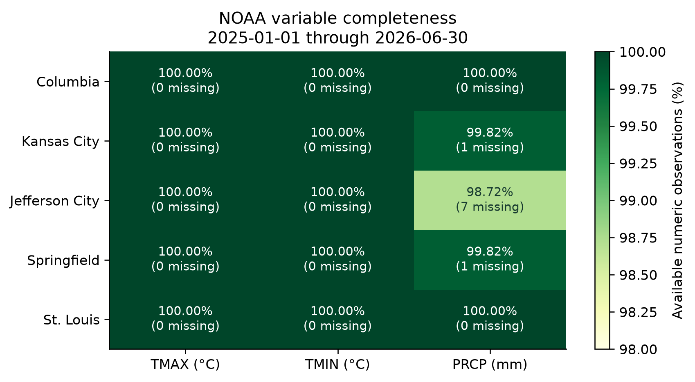
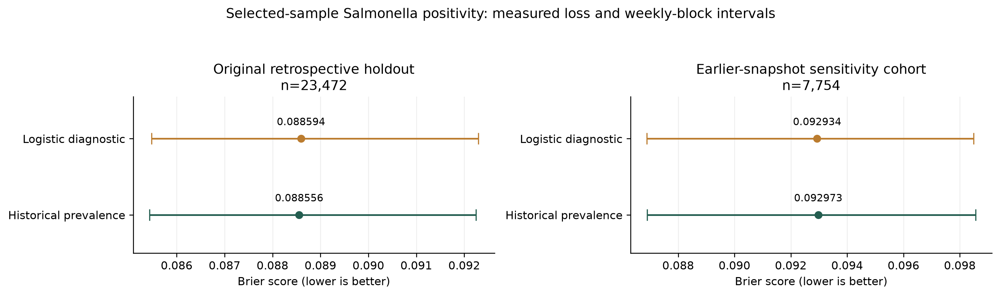
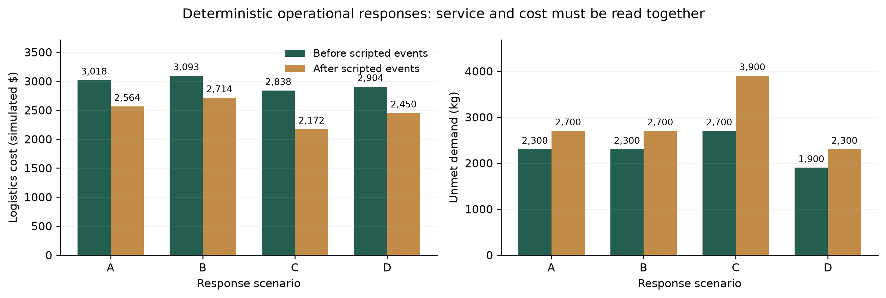

# AEGIS: Adaptive Early-warning & Guidance for Integrated Supply Chains

**Draft scientific competition report — genuine Kiro application usage, author signoff, and official-rubric review pending.**

Report compiled from saved artifacts on 2026-10-28. This document describes a local research prototype; it does not establish regulatory authority, operational certification, or prospective model validity.

## Abstract

AEGIS combines separately labeled food-safety evidence, public weather and road information, deterministic fictional Missouri logistics, and human-reviewed decision support. The saved raw-data audit inventories 42 files, with 0 recorded read errors and 0 exact duplicate hashes. A national FSIS primary-sample study evaluates Salmonella positivity using chronological validation; the transparent historical estimator remains operationally selected. Four constrained allocation responses expose service/cost tradeoffs, and a separate route laboratory supports one farm or multiple dispatch origins. Decisions remain proposed until dispatcher approval; the driver mode exposes approved assignments, advisories, cargo status, and incident reporting.

## 1. Operational question and scope

The initial actor is a regional poultry distributor serving Columbia, Kansas City, Jefferson City, Springfield, and St. Louis, Missouri. The route laboratory also represents a single farm dispatching several trucks and a fleet starting from multiple depots. Suppliers, commercial relationships, customer locations, trucks, lots, shipments, inventory, demand, costs, cargo telemetry, and thermal assumptions are simulated. Official facility markers and road geometry provide geographic context without validating fictional supply contracts.

The P0 submission scope is source integration/provenance, scientifically qualified model/baseline validation, at least three response scenarios, the requested genuine Kiro workflow, and report/code/demo artifacts. The interactive twin and optimization support that scope. An LLM assistant, account systems, and live sensors remain future extensions.

## 2. Data and provenance

The audit ran against `C:\Users\ericp\Downloads\NAFSI`. CSV and nested JSON are parsed without concatenating unrelated source tables; checksums detect exact duplicate downloads. JSON primary/secondary counts are preserved. Spreadsheet sheet dimensions are explicitly declared rather than exact observation counts. Errors, timestamps, sample missingness, and schemas appear in `data/manifests/inventory.json` and `reports/data_audit.md`.

| Evidence | Role | Scientific boundary |
|---|---|---|
| FSIS raw-poultry primary tests | National selected-sampling target and history | Primary Positive/Negative results only; secondary typing is not another primary sample |
| FSIS RTE example, other commodities, NARMS | Audited supporting files | Not silently pooled into a poultry training set |
| CDC BEAM exports | Human surveillance context | Separate denominators; no causal sample/outbreak linkage claimed |
| CDC NORS | Historical outbreak context | Separate from FSIS selected-sampling outcomes |
| FSIS official recalls | Dated official notices | No verified match to fictional lot identifiers |
| NOAA/NCEI daily summaries | Observed historical ambient weather | Reporting-period dates, attributes, quality flags, retrieval times kept separate |
| Open-Meteo forecast and archive | Forecast and historical reanalysis, respectively | Neither replaces observed station weather |
| NWS warnings | Official severe-weather advisories | Absence applies to the saved request/time only |
| MoDOT events and OSRM | Road evidence and ordinary driving estimates | Proximity screening is not closure-aware, truck-certified navigation |
| USDA food-access/environment workbooks | Audited food-security context | Not yet weighted into allocation without vintage/geography/denominator validation |

The saved connectivity probe recorded 13/18 HTTP successes. Documentation/catalog reachability is distinguished from working data feeds. Exact URLs, response types, request times, latencies, and failures are in `reports/api_status.json` and the API registry. These results describe the recorded probes, not guaranteed present availability.

Recorded probe failures:
- fsis_recalls: ConnectError: [Errno 11002] getaddrinfo failed
- fsis_sampling: ConnectError: [Errno 11002] getaddrinfo failed
- fsis_directory: ConnectError: [Errno 11002] getaddrinfo failed
- food_access: ConnectError: [Errno 11002] getaddrinfo failed
- food_environment: ConnectError: [Errno 11002] getaddrinfo failed

### 2.1 Bounded NOAA coverage

The actual NCEI extract covers 2025-01-01 through 2026-06-30: 5 verified station locations and 2,730/2,730 requested station-date rows. Overall status is **partial** because date coverage and variable completeness are separate. There are 9 missing requested variable values; no values were filled.

| Missouri location | Verified station | Latitude, longitude | Date rows / expected | Missing TMAX | Missing TMIN | Missing PRCP |
|---|---|---|---:|---:|---:|---:|
| Columbia | USW00003945 | 38.81704, -92.21475 | 546/546 | 0 | 0 | 0 |
| Kansas City | USW00003947 | 39.29747, -94.73087 | 546/546 | 0 | 0 | 1 |
| Jefferson City | USW00003963 | 38.59454, -92.15672 | 546/546 | 0 | 0 | 7 |
| Springfield | USW00013995 | 37.23983, -93.38995 | 546/546 | 0 | 0 | 1 |
| St. Louis | USW00013994 | 38.75246, -90.37342 | 546/546 | 0 | 0 | 0 |

NCEI requests explicitly specify metric units. Original bytes, station identities, coordinates, attributes, retrieval timestamps, and SHA-256 records are retained in `data/external/noaa/`. Blank quality flags indicate no recorded failed quality check; they do not imply error-free measurements. Daily reporting labels are not converted silently to UTC or local midnight. These observations have **not** been joined to FSIS: national establishment coverage, exposure linkage, and actual feature-publication times remain unvalidated.



*Figure 1. Numeric variable completeness within the requested station/date window. Cell annotations include missing-value counts. Full date-row coverage does not imply complete precipitation coverage.*

## 3. Sampling-outcome feasibility study

The modeled quantity is positivity in a selected FSIS raw-poultry primary Salmonella sample. It is not the probability of consumer illness, nor a farm-, shipment-, or lot-specific contamination probability. The ingestion adapter verifies embedded product metadata, retains establishment/project/date identifiers, excludes secondary typing from the target, and rejects conflicting duplicate sample identifiers.

The original feasibility evaluation uses 48,361 training and 23,472 validation rows, with a 90-day embargo. Its held-out dates are 2025-08-29 through 2026-06-30. Features are lagged national historical prevalence and calendar seasonality. The assumed 90-day reporting lag is not an empirically verified publication date.

| Estimator: original retrospective cohort | Validation samples | Brier | 95% week-block bootstrap interval | PR-AUC (AP) | ROC-AUC |
|---|---:|---:|---|---:|---:|
| Smoothed historical prevalence | 23,472 | 0.08855575 | 0.085435 to 0.092244 | 0.098117 | 0.500000 |
| Logistic regression diagnostic | 23,472 | 0.08859440 | 0.085476 to 0.092292 | 0.098141 | 0.498029 |

Lower Brier is better. The original logistic model does not improve upon the baseline in this held-out cohort. Calibration, precision/recall at the documented threshold, and state-level error analysis are retained in `reports/model_evaluation.json`. There are no invented accuracy percentages.

### 3.1 Availability sensitivity analysis

A separate frozen-source analysis uses only earlier source snapshots created on or before 2026-03-19. It fits 57,459 eligible FY2024/FY2025 rows and evaluates 7,754 FY2026 samples dated 2026-03-20 through 2026-06-30. No held-out outcomes update either estimator. The later FY2026 file is used only to score frozen predictions.

| Estimator: frozen earlier-snapshot cohort | Validation samples | Brier | 95% week-block bootstrap interval | PR-AUC (AP) | ROC-AUC |
|---|---:|---:|---|---:|---:|
| Frozen smoothed historical prevalence | 7,754 | 0.09297314 | 0.086902 to 0.098556 | 0.103559 | 0.500000 |
| Calendar-only logistic diagnostic | 7,754 | 0.09293427 | 0.086890 to 0.098492 | 0.101889 | 0.499197 |

Metadata creation dates are **not verified public release dates**. Row-level result availability and historical as-of revisions remain unknown. The small numerical difference in this sensitivity study does not justify replacing the transparent historical estimator. Prospective validation remains unestablished. The two reported cohorts differ; their absolute losses should not be interpreted as a before/after model improvement.



*Figure 2. Measured Brier scores with weekly-block bootstrap intervals. Panels use different held-out samples. Intervals summarize held-out weekly variation and do not quantify selection or publication-lag uncertainty.*

## 4. Simulated digital twin and four response scenarios

The saved demo uses seed `20261026`. The core network contains three simulated suppliers, two DCs, fifteen destinations, eight refrigerated trucks, twelve lots, and twenty-four candidate shipments. The single-wave allocation maximizes served demand less simulated logistics cost under hard inventory, supplier/DC capacity, truck eligibility/refrigeration/capacity, lot hold/recall, destination demand, deadline, and shelf-life constraints. It does not represent a full replenishment system or physical dispatch.

A retains original candidate lots. B adds targeted verification requirements and cost. C proposes precautionary holds for dispatcher review. D permits eligible simulated supply substitution. Predictive scores alone do not create mandatory holds. Held or recalled lots cannot be assigned regardless of objective weights.

### 4.1 Baseline seed results

| Scenario | Solver | Logistics cost (simulated $) | Unmet demand (kg) | Candidates not selected | Review-priority selections | Violations |
|---|---|---:|---:|---:|---:|---:|
| A - Baseline distribution | OPTIMAL | 3,018 | 2,300 | 11 | 1 | 0 |
| B - Targeted verification | OPTIMAL | 3,093 | 2,300 | 11 | 1 | 0 |
| C - Precautionary hold pending review | OPTIMAL | 2,838 | 2,700 | 12 | 0 | 0 |
| D - Alternative eligible supply | OPTIMAL | 2,904 | 1,900 | 10 | 1 | 0 |

### 4.2 Results after scripted operational events

| Scenario | Solver | Logistics cost (simulated $) | Unmet demand (kg) | Candidates not selected | Review-priority selections | Violations |
|---|---|---:|---:|---:|---:|---:|
| A - Baseline distribution | OPTIMAL | 2,564 | 2,700 | 12 | 2 | 0 |
| B - Targeted verification | OPTIMAL | 2,714 | 2,700 | 12 | 2 | 0 |
| C - Precautionary hold pending review | OPTIMAL | 2,172 | 3,900 | 15 | 0 | 0 |
| D - Alternative eligible supply | OPTIMAL | 2,450 | 2,300 | 11 | 2 | 0 |

The scripted narrative introduces simulated road delay and cargo temperature excursion. Lower logistics cost after disruptions can result from serving fewer shipments; it is not necessarily a better response. The tradeoff must be interpreted alongside unmet demand and review requirements. Food waste is not equated with unsent stock; the six-hour wave does not generate expiry in the current assumptions.



*Figure 3. Four response scenarios before and after the scripted events. Costs are simulated dollars. Demand/cost differences are synthetic decision-support results, not measured commercial savings.*

## 5. Single-farm and multi-origin route laboratory

The route laboratory is a separate what-if tool sharing the same backend and map. It supports multiple trucks, stop demands, loading inventory, eligibility, service time, deadlines, and return to each truck's origin. It does not create accounts or alter approved driver assignments. A deterministic thermal scenario projects temperature under declared ambient/fault assumptions; it is uncalibrated and produces no learned refrigeration-failure probability.

| Preset | Origins / available trucks / stops | Solver | Matrix fallback | Planned routes | Fleet distance (km) | Total vehicle-hours | Cost (simulated $) | Unmet demand (kg) | Violations |
|---|---|---|---|---:|---:|---:|---:|---:|---:|
| Single-farm dispatch | 1 / 3 / 8 | FEASIBLE | False | 2 | 164.611 | 4.789 | 330.46 | 300 | 0 |
| Multi-location fleet | 2 / 8 / 15 | FEASIBLE | False | 5 | 1,195.783 | 18.416 | 1,924.10 | 500 | 0 |

These rows come from actual low-volume OSRM requests and saved OR-Tools results in `reports/route_lab_osrm.json`. A FEASIBLE status is not a global-optimality proof. Vehicle-hours sum all planned vehicle elapsed times and may exceed one vehicle's shift limit. The designated held stop remains unserved in each saved preset; its demand is not silently discarded.

Real road incidents are screened against returned route geometry with a 250-meter proximity/intersection buffer. Nearby parallel roads and duplicate point/line event representations can generate review alerts. Public OSRM driving routes do not incorporate current MoDOT closures automatically and do not validate truck height, weight, hazardous-material restrictions, or legal access. Every alternative requires dispatcher and commercial-vehicle review; none is asserted truck-safe.

## 6. Human approval and AEGIS Drive

Command and Drive are responsive modes in one application with a shared FastAPI/SQLite backend. Drive provides approved shipment information, disruption advisories, cargo-temperature status, and incident reporting. It is intended for use while parked. Dispatcher approval requires an identity and reason, rejects stale network revisions, revalidates safety constraints, publishes assignments transactionally, and retains an audit trail. Local identities remain self-declared; production access control is outside this prototype.

The accelerated isolated workflow recorded 13 approved simulated assignments. Acknowledgment recorded: True; incident recorded: True; operator database modified by that rehearsal: False. This validates the scripted sequence without claiming a completed five-minute live presentation.

## 7. Reproducibility and verification

Required inputs, retrieval records, seeds, commands, and test artifacts remain inspectable. This report compiler performs no new HTTP requests. Its input-file hashes are recorded in `reports/figures/input_manifest.json`; regenerating after evidence changes updates the draft transparently.

The saved validation artifact records 443 passing pytest tests, 77 passing Vitest tests, frontend build status `passed`, and 28 real HTTP checks. Browser visual QA: `Dated actual-Chrome core and guided rehearsal checks; see each artifact for counts, failures and source freshness`. These are the artifact's recorded results; final session verification and author signoff must be refreshed before submission.

```powershell
.venv/Scripts/python scripts/audit_data.py
.venv/Scripts/python scripts/ingest_fsis.py
.venv/Scripts/python scripts/ingest_evidence.py
.venv/Scripts/python scripts/train_model.py
.venv/Scripts/python scripts/acquire_noaa.py
.venv/Scripts/python scripts/validate_model_timing.py
.venv/Scripts/python scripts/demo_run.py
.venv/Scripts/python scripts/build_submission_report.py
.venv/Scripts/python -m pytest -q
```

Frontend build/test and local startup commands are in `README.md`. Source refresh and route-laboratory runs require internet; dated evidence and labeled estimates support a limited offline demonstration.

## 8. Limitations and submission readiness

- No validated prospective contamination or consumer-illness prediction is claimed. Source selection, missing publication dates, retrospective revisions, and transportability constrain interpretation.
- NOAA coverage is a bounded five-station extract. Weather is not scientifically linked to national FSIS outcomes, farm production, or cargo safety.
- Thermal projections are scenario calculations with declared assumptions; live sensors and calibrated cargo models are absent.
- Allocation and route-laboratory outputs describe different synthetic decision problems. Neither establishes commercial savings or complete upstream replenishment.
- Verified recall matching requires genuine establishment/product/lot/date traceability, which fictional lots cannot supply.
- Truck-safe routing, production authorization, live sensing, farm/enterprise account systems, and an LLM operations assistant remain outside the validated submission core.
- Genuine AWS Kiro application use remains pending. Codex-prepared `.kiro/` files do not demonstrate using Kiro.
- Official challenge rubric, submission rules, required Kiro evidence, final author review, and the timed presentation must be confirmed before this draft becomes a final submission.

## References and primary-source documentation

1. USDA FSIS. [Laboratory Sampling Data](https://www.fsis.usda.gov/science-data/data-sets-visualizations/laboratory-sampling-data). Embedded metadata in the supplied FY2024–FY2026 raw-poultry files defines primary/secondary tests and warns against inferring outbreak causality.
2. USDA FSIS. [Official recall API](https://www.fsis.usda.gov/fsis/api/recall/v/1). Dated response artifacts retain source and retrieval timestamps.
3. NOAA NCEI. [Access Data Service API documentation](https://www.ncei.noaa.gov/support/access-data-service-api-user-documentation). Explicit dataset, station, date, units, attributes, and station-location parameters.
4. NOAA NCEI. [GHCN-Daily format and quality flags](https://www.ncei.noaa.gov/pub/data/ghcn/daily/readme.txt).
5. CDC. [NORS data](https://www.cdc.gov/nors/data/) and [BEAM dashboard](https://www.cdc.gov/beam/dashboard/).
6. MoDOT. [Traveler Information ArcGIS service](https://mapping.modot.mo.gov/arcgis/rest/services/TravelerInformation/TravelerInformationData/MapServer).
7. Project OSRM. [HTTP API](https://project-osrm.org/docs/v26.6.1/http/).
8. NAFSI Hub. [Public challenge announcement](https://nafsihub.org/). Public announcement review does not replace the full official rubric.

## Appendix: operational workflow extension

Custom planning now accepts explicitly user-entered origins, delivery stops, inventory, deadlines, shelf life and truck assignments. These inputs describe experiments; they are not independently verified establishments, contracts or recall matches. The bounded editor supports up to three origins, twenty stops and ten trucks. Custom experiments remain separate from approved Command assignments.

The dispatcher desk links newly submitted driver incidents to identified review, manual lot holds/releases and versioned instructions. Original reporting context is retained. Holds remove affected assignments; release does not restore them automatically. Driver acknowledgment checks the current instruction version separately from the original assignment acknowledgment. Dispatcher identities remain self-declared in the local prototype.

The recorded isolated workflow reports passed=True, stale-instruction acknowledgment rejected=True, held-lot assignments removed=True, and release-without-redispatch verified=True. Operator database modified=False. Evidence: `reports/operations_demo.json`; methods: `docs/operations_workflow.md`.

The dedicated mobile-responsive Drive view presents approved destination, planned travel, simulated fuel/range and dispatch-origin position, cargo temperature and workflow status. Driver reports and acknowledgments require an expiring parked declaration checked transactionally by the server; this is not actual motion detection. Quick reports retain trip context in the dispatcher inbox. Bulk recall evidence is explicitly bounded in the UI while complete source caches remain unchanged.

These workflow improvements do not resolve missing publication timestamps, validate cargo thermal coefficients, establish production authorization, or supply genuine Kiro execution evidence.

## Appendix: historical county context and source integrity

The USDA Food Environment Atlas extract records status=available. It contains 115 Missouri counties/county-equivalents and 10 supported variables. Release note: The original release date of this file is July 2025.. Exact source bytes, metadata, missing-cell codes and derived-file checksum are described in `reports/usda_food_environment.json`.

The inspected measures use 2019 access, 2020 grocery-store and 2023 SNAP-authorized-store vintages. Their population/housing-unit denominators remain distinct. Missing and suppressed values stay null. Counties are identified by FIPS; repeated names do not imply the same geography. No route-coordinate linkage, current demand estimate, food-safety score or allocation weight is inferred.

Saved null counts: {'LACCESS_POP19': 0, 'PCT_LACCESS_POP19': 0, 'LACCESS_LOWI19': 0, 'PCT_LACCESS_LOWI19': 0, 'LACCESS_HHNV19': 0, 'PCT_LACCESS_HHNV19': 0, 'GROC20': 39, 'GROCPTH20': 39, 'SNAPS23': 0, 'SNAPSPTH23': 0}. This county context is displayed separately from FSIS outcomes and CDC evidence.

The content-based re-import checked 8 previous derived tables. All checked frame values/dtypes were unchanged: True. Model artifact hashes unchanged: True. Exact-byte duplicate downloads are not pooled; differing exports for one supported semantic table are explicit conflicts. Source-browser checksums and displayed values use the same immutable request snapshot. Schema recognition establishes supported structure, not provider authenticity or publication availability. See `reports/ingestion_verification.json`.

Dispatch readiness is read-only: thirteen constraint diagnostics and three workflow checks expose current resource use, eligibility, acknowledgments and targeted verification. Passing listed checks does not dispatch, consume inventory, certify food safety or validate commercial-truck restrictions. No model score creates a mandatory hold.