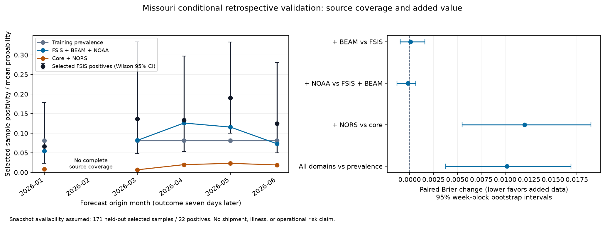

# Conditional Missouri integrated modeling study

conditional retrospective multi-source feasibility; prospective skill unestablished

Salmonella positivity in a selected Missouri FSIS raw-poultry primary sample collected 7 days after forecast origin

Complete-case coverage: 490 of 1534 selected MO samples. Primary training: 255; validation: 171 with 22 positive results.

## Performance on the identical held-out cohort

| Model | Brier | PR AUC/AP | ROC AUC | Mean prediction |
|---|---:|---:|---:|---:|
| baseline | 0.11431 | 0.1287 | 0.5000 | 0.0817 |
| fsis | 0.11256 | 0.1722 | 0.6068 | 0.0894 |
| fsis_cdc | 0.11265 | 0.1664 | 0.5995 | 0.0885 |
| core_integrated | 0.11246 | 0.1529 | 0.5853 | 0.0890 |
| with_nors | 0.12449 | 0.1676 | 0.5740 | 0.0156 |

## Paired added-domain ablations

Brier change = augmented − reference; negative is lower error. Intervals resample the same validation weeks for both models.

- PulseNet-derived BEAM aggregate: ΔBrier 0.00009, 95% interval [-0.00097, 0.00159]. Paired interval includes zero; added value not established.
- NOAA ambient context: ΔBrier -0.00020, 95% interval [-0.00131, 0.00064]. Paired interval includes zero; added value not established.
- NORS exported outbreak-record context: ΔBrier 0.01203, 95% interval [0.00549, 0.01896]. Higher Brier in this conditional holdout; added source did not improve calibration/error.
- All integrated domains: ΔBrier 0.01018, 95% interval [0.00379, 0.01689]. Higher Brier in this conditional holdout; added source did not improve calibration/error.

## Availability and alignment

Origins precede collection by 7 days. FSIS results are assumed available 90 days after collection; BEAM monthly counts 90 days after month-end; NORS monthly records 730 days after month-end; NOAA observations 7 days after their reporting-period label. The NOAA predictor is the trailing 28-calendar-day average ending origin−7 days, requiring all five stations to pass documented quality checks every day. Training labels must become assumed-available strictly before the validation start. Scalers and logistic regressions fit training data only. No contemporaneous/future outcome or CDC label is used as an FSIS feature.

Raw NOAA bytes and processed analytic source files are SHA-256 verified against ingestion metadata. Data records carry outcome date, origin, each source observation period, assumed availability dates, and exclusion reasons. Actual NOAA cache retrieval dates and FSIS snapshot creation dates are recorded separately; exact original BEAM/NORS retrieval times are unknown. These assumptions cannot reconstruct unavailable historical snapshot vintages.

## Scientific limits

- This is a conditional retrospective feasibility study. NOAA cache retrieval and FSIS snapshot-creation metadata postdate the modeled origins. Exact original BEAM/NORS retrieval timestamps were not recorded. Assumed lags are not evidence that these exact revised snapshots were available then; no prospective forecast validation or operational activation is claimed.
- Target is positivity in selected FSIS raw-poultry surveillance samples in Missouri, conditional on being sampled. Backdating the forecast origin does not validate forecasting whether a future sample will be selected. It is not lot contamination, probability of illness, representative state prevalence, or a linkage from a human isolate to a food sample.
- BEAM human Salmonella counts are PulseNet-derived aggregate surveillance context. State, pathogen, and time alignment provide no genomic linkage, epidemiological attribution, or outbreak causation; CDC records remain separate predictors and never become FSIS outcome labels.
- NOAA is an equal-weight five-airport Missouri ambient index. Requiring all five quality-pass station values for each of 28 days can exclude many samples. This index is not establishment exposure, route weather, cargo telemetry, or statewide representative sampling.
- NORS counts exported Missouri foodborne Salmonella outbreak records, not illnesses. Absent qualifying rows mean no matching record in this snapshot, not no outbreak. Its observation window ends in 2023; the latest period is capped at this source end, never extrapolated with future zeros. NORS and the broader BEAM system are not independent surveillance systems; the BEAM predictor here uses human isolate counts only.
- All models and ablations use the identical complete-case cohort; coverage exclusion can bias the cohort. No station, state, or source missingness is imputed. Two additional datasets overall are NORS here and USDA county food-access context in separate UI/evidence artifacts; food-access deprivation is not treated as a contamination predictor and does not weight simulated destinations without a verified county crosswalk.
- Regularization, feature sets, January 2026 primary split, 90-day fitting embargo, and 0.10 diagnostic review threshold are configured without holdout hyperparameter tuning; this is not a preregistered study. Source lags lack external validation; a different plausible lag could change or eliminate the study cohort.
- Week-block bootstrap intervals describe sampling variation within the held-out weeks, with 400 resamples. They do not capture publication/revision uncertainty, all spatial dependence, model-selection uncertainty, or individual prediction intervals. Sparse positive results make discrimination unstable.
- Calibration and time-series Wilson intervals assume independent Bernoulli observations. Repeated establishments and temporal dependence violate that approximation; these descriptive bands are not cluster-adjusted inferential intervals.
- Diagnostic false positives mean negative selected samples prioritized for review; false negatives mean positive selected samples not prioritized. Counts are not estimates of prevented illness, regulatory violations, or avoidable waste. Any hold requires human approval; held or recalled lots cannot dispatch.
- Standardized coefficients describe conditional associations among correlated features, not causal mechanisms. Constant training features and uncertainty spanning zero must not be presented as demonstrated added value.
- The primary holdout NORS feature is constant while training spans two values. Its worse Brier score reflects this sparse, old exported-record context and temporal distribution shift; it does not establish that NORS generally lacks value.

## Reproduce

`.venv/Scripts/python.exe scripts/train_integrated_study.py`

This writes separate study artifacts and does not change `reports/model_evaluation.json`, the operational risk selection, raw downloads, or operator state.

CDC source definitions: [BEAM overview](https://www.cdc.gov/beam/about/index.html), [Report Data metadata](https://data.cdc.gov/Foodborne-Waterborne-and-Related-Diseases/BEAM-Dashboard-Report-Data/jbhn-e8xn).
